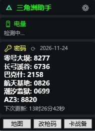

# 三角洲助手

面向《三角洲行动》国服玩家的非官方 Windows 桌面工具。悬浮窗显示蓝牙键鼠电量和每日密码，并提供地图、改枪码和卡战备入口。

## 下载与运行

1. 从 [Releases](https://github.com/wangbahe/DeltaForceToolbox/releases) 下载 `DeltaForceToolbox.exe`。
2. 使用 Windows x64，并安装 [.NET 8 桌面运行时（x64）](https://dotnet.microsoft.com/download/dotnet/8.0)。内置网页需要 [Microsoft Edge WebView2 Runtime](https://developer.microsoft.com/microsoft-edge/webview2/)。
3. 双击 EXE。要随游戏启动和退出，在「设置 → 启动方式」选择对应选项。

| 功能 | 默认快捷键 |
| --- | --- |
| 地图 | `Ctrl+Alt+7` |
| 改枪码 | `Ctrl+Alt+8` |
| 卡战备 | `Ctrl+Alt+9` |

三个网页入口和快捷键均可在设置里自定义。密码旁的刷新按钮可以立即重新查询。

## 软件截图

**桌面悬浮窗**

**内置卡战备窗口**（页面来源：三角洲云码库）

## 反馈

欢迎在 [Issues](https://github.com/wangbahe/DeltaForceToolbox/issues) 提交 Windows 版本、软件版本和复现步骤。蓝牙电量取决于设备是否提供电量服务。游戏内快捷键及独占全屏表现仍待实机验证。

网页功能需要联网，三个入口默认由三角洲云码库提供。
